# CompositeQuery v2 Design

Status: accepted-focused implementation record; repository-full validation deferred to PHASE-69.7

Acceptance: [Phase 69.5 closure journal](../journal/2026/09/2026-09-29-phase-69.5-composite-query-v2.md).

CompositeQuery v2 is a caller-side coordinator over the existing CNCF Job
engine. The caller owns the supplied scheduler and its lifecycle. The
coordinator owns only branch declarations, invocation-local result state,
cancellation registrations, and captured Job IDs.

```mermaid
flowchart LR
  Caller[Caller ExecutionContext] --> Gate[Preflight and nested-worker guard]
  Gate --> Coordinator[Caller-thread DAG coordinator]
  Coordinator --> Engine[Owning CNCF JobEngine]
  Engine --> Task[CompositeQueryV2BranchTask]
  Task --> Protocol[Strict in-process V2 protocol]
  Protocol --> Target[Target Subsystem query-only boundary]
  Target --> Result[Ordered ephemeral aggregate]
```

The coordinator uses a single monitor for logical branch status and admission
reservations. It reserves before submit, limits actual running query bodies to
the policy ceiling, and waits with bounded `wait/notify` intervals on the
caller thread. Query dispatch, scheduler calls, cancellation callbacks,
response serialization, and Job control happen outside that monitor. A timed
out or cancelled running task keeps its physical reservation until the query
body exits, preventing over-admission while a non-cooperative provider still
uses a worker. Canonical settlement remains logically distinct, so a refused
or absent durable callback cannot publish a staged value or free the
reservation before canonical settlement or logical terminal state plus body
exit. Request expiry seals incomplete branches without choosing a fallback;
only branch-local timeout can select an explicitly eligible fallback.

`CompositeQueryV2BranchTask` is the JobEngine adapter. Its Job result is
`Void` or a fixed sanitized outcome. The query response stays in the
invocation-local callback channel and is published only from the Job task's
canonical outcome or admission-failure hook. A late callback cannot replace a
sealed branch result.

The protocol directory is immutable and holds only registered in-process
`Subsystem` references. `Local` resolves to the owning subsystem. A named
target cannot be an implicit URL, path, global runtime, or request credential.
The target executes through `executeQueryOnlyWithMetadata`, so its existing
selector resolution, operation authorization, and Query-only restriction remain
the authority.

Branch context construction starts from a fresh target component context. It
uses the target runtime, scope, resources, resource trees, UnitOfWork lineage,
and fresh response cell while retaining the caller's identity and correlation.
It resets operation evaluation and disables calltree/inline/save/trace-job
flags. This is deliberately implemented in the composite package through the
existing package-visible context copy primitives; `ExecutionContext`,
`RuntimeContext`, `UnitOfWork`, `ComponentLogic`, and `Subsystem` retain their
existing responsibilities.

Persistent diagnostics remain within the existing Job lifecycle. Their task
input and parameters are empty, their summary is fixed, and the branch task
does not return the query response. The design does not add a persistence
provider, custom store, transport, or scheduler.

The submitted Job envelope retains the caller's existing security, owner
resources, configuration, and scheduler context. It transforms only the
operation-evaluation buffer, response cell, and calltree flags required for
diagnostics-only composition. Target branch construction then preserves the
full caller security/trace while replacing runtime, scope, resources, and
UnitOfWork with the target component template.

Affected v1 consumers are the existing CompositeQuery engine and the StaticWeb
page context provider. They retain their original shape because V2 is exposed
only by the additive facade. The independent Job, context, authorization, and
page consumer specifications are the focused compatibility boundary.

## Current native diagnostics realization — JM69-10C8

status=focused_validation_passed
manifest=PHASE-69.7-JM69-10C8-implementation01@2
validation_status=subject8-REP010-ACC002-passed
acceptance_status=not-accepted

The sole coordinator reservation construction supplies
`persistentDiagnostics = policy.persistence == PersistentDiagnostics` to the
existing branch adapter. Only that selection changes its metadata to the
native closed Operation/operation/composite-query-v2/no-service/
composite-query-v2/root/own/per-task descriptor. Running/Committed/Failed are
the original engine's canonical wrapper-task outcomes. The Query's own
authorization and target UnitOfWork retain their existing responsibilities.
Task body, staged scalar callback, physical-body exit, ID capture, width,
cancellation, deadlines and fallback behavior retain the accepted design.
Ephemeral metadata and persistence default remain unchanged.

The [C8 native process composition](job-cross-process-acceptance.md#compositequery-native-process-composition)
binds `new CompositeQueryEngine(native.subsystem)` to the actual original
configured native engine. The separate existing CompositeQueryV2Fixture has
no supplied native engine; its immutable `target-c8` entry selects the real
Query subsystem. Its own unused fixture engine and subsystem engine receive
no submissions. Subsystem is final: inheritance, setters, reflection, private
engine replacement and transparent submission delegates are unnecessary.

One owned caller Thread performs the public facade invocation; the original
writer REALTIME scheduler performs ordinary Async work. The returned
diagnostic IDs identify each actual job. `awaitResult(id,5000L)` followed by
the original native state-monitor read barrier observes terminal signed
checkpoint completion after the aggregate callback. Successful live Task
results are `Void`, signed results are `Succeeded(Absent)`, and six genuine
keyed-source boundaries retain original authorization/definition and paid
2/96/1/1 with remaining0. Original realtime maintenance may perform empty
retention polls; its counts are observed without a fixed-count assertion.

An independent MANUAL reader registers those original terminal records,
observes no executable tasks or Query calls and drains the original reader
engine once with zero work. The local complete Job/quota rows, payments and
read/runtime counters establish body-free unchanged reads. All caller,
fixture/target/native engines, timers, worker pools, optional schedulers,
logical bindings, owned nodes and physical native SQL close before receipts.
Failures retain their primary exception with cleanup errors suppressed.
Authoring does not establish selected validation or independent acceptance;
the Phase69.5 accepted-focused history and Phase69.7 deferred-full obligation
remain unchanged.

## Current C8 selected validation — 2026-10-06

Initial authored_validation_pending/planned-not-run is historical. Parent-admitted
current subject8 selected Slice validation is complete:
[JM69-10C8-representative10-result.json@1](../../.codex-workflow/phases/PHASE-69.7/JM69-10C8-representative10-result.json)
records PH697-JM10C8-REP-010,8 completed suites/66 tests,66 succeeded, pending0;
[JM69-10C8-accumulator02-result.json@1](../../.codex-workflow/phases/PHASE-69.7/JM69-10C8-accumulator02-result.json)
records PH697-JM10C8-ACC-002,128 completed suites/1050 tests,1050 succeeded,
with only original SqliteDataStoreSpec pending1. Both invocation summaries use
cncf.sbt.invocation-summary.v1 and report failed0/aborted0/canceled0/ignored0,
compile_failed=false, compilerwarnings0, typed reader exit0/SBT exit0/wrapper
exit0, consumed permission and serial lock=released. Result records retain the
actual log/summary paths and completion markers.

The [C8 journal chronology](../journal/2026/10/2026-10-05-phase-69.7-composite-query-native-diagnostics.md#current-c8-validation-chronology--2026-10-06)
retains the original no-edit binding mismatch, five bounded pre-review corrections,
historical REP008 subject6 success, failed ACC001/CP003 and REP009 subject7,
external human dependency recovery and actual generated-only CP004 PASS. Latest
selected Cozy0.3.3-SNAPSHOT remains; compatible external dependency recovery
resolved this run without establishing publisher identity or importing/accepting
future Phase100 APIs. CQNT1..CQNT9, genuine process/property/native/canonical/
privacy/payment/cleanup oracles and all historical receipts remain unchanged.
This documentation projection consumes no repair unit or counter reset.

JM69-09 remains DONE; JM69-10 remains OPEN; Phase69.7 remains IN_PROGRESS.
Original whole-JM10 protected M2 independent Step review and local acceptance
commit remain pending. Actual admitted CBD provider -> Entity -> completed full
Review, independent fresh real recovery, remaining original matrix/positive
started-work choice, compatibility/accepted guidance promotion, predecessor
deferred-full validation, aggregate full CNCF/downstream validation, sole original
epoch1 comprehensive Phase review and final local Phase release remain owed.
Original Goal/authority/base/binding/epochs/history/ledgers/budgets/counters and
other authors' work remain. Parent owns diff/link/status verification, validation,
review and transitions; this editor runs no validation or self-review.
